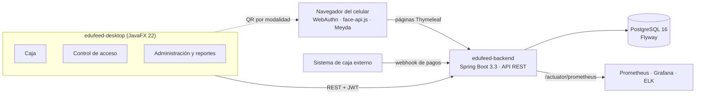

<div align="center">
  <h1>EduFeed</h1>
  <p><b>Sistema de gestión para restaurante escolar con autenticación biométrica</b><br/>Control de acceso, pagos y reportes para el comedor de una institución educativa</p>

  
  
  
  
  
  
  [](LICENSE)

  <p>
    <a href="docs/architecture.md">Arquitectura</a> ·
    <a href="docs/autenticacion-biometrica.md">Biometría</a> ·
    <a href="docs/api-reference.md">API</a> ·
    <a href="docs/manual-instalacion.md">Instalación</a> ·
    <a href="docs/manual-usuario.md">Manual de usuario</a>
  </p>
</div>

<details>
<summary><b>English summary</b></summary>

EduFeed is a management system for a school cafeteria. Students and staff identify themselves with biometrics (WebAuthn passkeys on their phone, face recognition or voice), and the system checks whether they have a valid meal entitlement (daily, monthly or prepaid package) before letting them in. Cashiers register payments, entitlements are generated automatically, and administrators get attendance, income and rejection reports.

It is a multi-module Maven project: a Spring Boot 3.3 REST API (Java 21, PostgreSQL 16 with Flyway, JWT with refresh tokens, AES-256-GCM encrypted biometric templates), a JavaFX 22 desktop client for cashiers, access control and administration, and a pluggable biometric module. It ships with Docker Compose, a GitHub Actions pipeline and an optional Prometheus, Grafana and ELK stack. Academic project from UNIMINUTO (2025).
</details>

## Qué es

Un restaurante escolar necesita saber, en el momento en que alguien llega a la fila, si esa persona pagó el servicio de hoy. Cuando el control se hace con listas en papel o con fichas, es fácil que alguien entre sin derecho, que se pierda la trazabilidad de quién comió y que los reportes de ingresos se armen a mano al final del mes.

EduFeed resuelve ese flujo de punta a punta. El cajero registra el pago (diario, mensual o por paquete de días) y el sistema genera el derecho de uso con su vigencia. En el punto de acceso, la persona se identifica con biometría; el backend valida el derecho vigente, registra el intento con su resultado y, si no hay derecho, orienta a la persona hacia la caja. Los administradores consultan asistencias, ingresos, rechazos y derechos activos, y pueden exportarlos.

Los requisitos no funcionales del proyecto apuntan a 500 usuarios concurrentes; los escenarios de carga están descritos en [`docs/performance.md`](docs/performance.md).

## Funcionalidades

| Módulo | Qué hace |
| --- | --- |
| **Usuarios** | Registro de niños, estudiantes, docentes y personal; búsqueda por documento, nombre o tipo; desactivación y reactivación |
| **Biometría** | Enrolamiento y verificación por huella (passkey WebAuthn en el teléfono), rostro y voz. El escritorio genera un código QR por modalidad y el usuario completa la captura desde el navegador del celular |
| **Pagos y derechos** | Pagos diarios, mensuales y por paquete; aprobación, rechazo y reversión; generación automática del derecho de uso y control de vigencias |
| **Integración con caja** | Webhook `POST /api/webhooks/pagos` para recibir pagos externos y conciliación de transacciones |
| **Control de acceso** | Verificación en tiempo real del derecho vigente, registro de cada intento (fecha, hora, modalidad, estado, motivo) y orientación a caja en caso de rechazo |
| **Reportes** | Ingresos, asistencias, rechazos y derechos activos, con exportación CSV desde la API y PDF/CSV desde el escritorio; panel financiero y gestión de paquetes |
| **Auditoría** | Registro de operaciones críticas mediante listeners de JPA |

Roles definidos: `ADMIN`, `OPERADOR_CAJA`, `OPERADOR_ACCESO`, `AUDITOR` y `SUPERVISOR`.

## Arquitectura



- **Proyecto Maven multi-módulo.** `edufeed-backend` (API), `edufeed-desktop` (cliente JavaFX), `edufeed-biometric` (interfaz común de proveedores biométricos) y `edufeed-common`.
- **Biometría desde el teléfono.** La captura ocurre en páginas servidas por el backend: la huella se resuelve con passkeys WebAuthn (verificación de firma EC/RSA y `signCount` contra repetición), el rostro con descriptores de 128 dimensiones de face-api.js y la voz con coeficientes MFCC extraídos con Meyda. El escritorio muestra el QR y consulta el estado de la sesión.
- **Proveedores enchufables.** El módulo `edufeed-biometric` define `BiometricProvider` con implementaciones simuladas para desarrollo (`EDUFEED_BIOMETRIC_PROVIDER=mock`) y envoltorios preparados para lectores DigitalPersona, ZKTeco y Suprema, que aún no integran el SDK del fabricante.
- **Datos biométricos protegidos.** No se guardan imágenes ni audio: solo vectores, cifrados con AES-256-GCM antes de persistirse.
- **Seguridad.** JWT de acceso (1 hora) y de refresco (14 días), contraseñas con BCrypt y autorización por roles.
- **Esquema versionado.** Seis migraciones Flyway (`V1` a `V6`) y zona horaria `America/Bogota` aplicada en la sesión de PostgreSQL.

## Stack tecnológico

| Capa | Tecnología |
| --- | --- |
| Backend | Java 21, Spring Boot 3.3.13 (Web, Data JPA, Security, Validation, Thymeleaf, Actuator) |
| Base de datos | PostgreSQL 16, Flyway |
| Seguridad | JWT (jjwt 0.12.5), BCrypt, AES-256-GCM, WebAuthn |
| Documentación de API | springdoc-openapi 2.6 (Swagger UI) |
| Escritorio | JavaFX 22.0.2, OkHttp, Jackson, ZXing (QR), iText 8 (PDF), JFreeChart |
| Biometría | WebAuthn, face-api.js, Meyda, OpenCV 4.9 (binding openpnp) |
| Pruebas | JUnit 5, Spring Security Test, Testcontainers, JaCoCo, Gatling, k6 |
| Infraestructura | Docker, Docker Compose, GitHub Actions (GHCR), Prometheus, Grafana, Alertmanager, ELK |

## Puesta en marcha

### Requisitos

- JDK 21 o superior (el Dockerfile y el pipeline de CI usan Temurin 24)
- Maven 3.9+
- Docker Desktop, o una instancia local de PostgreSQL 16

### 1. Base de datos

```powershell
# Windows: copia .env.example a .env si no existe y levanta los contenedores
pwsh -NoProfile -ExecutionPolicy Bypass -File ./scripts/db-up.ps1
```

```bash
# Linux / macOS
./scripts/setup-dev.sh
```

Si prefieres una PostgreSQL local, crea la base `edufeed` y configura `DB_URL`, `DB_USER` y `DB_PASSWORD`. Flyway crea el esquema al arrancar el backend.

### 2. Compilar

```bash
mvn clean install
```

### 3. Backend

```bash
cd edufeed-backend
mvn spring-boot:run
```

- API: `http://localhost:8080/api`
- Swagger UI: `http://localhost:8080/swagger`
- Métricas: `http://localhost:8080/actuator/prometheus`

Al arrancar se crea un operador administrador con las variables `SEED_OPERATOR_USERNAME` y `SEED_OPERATOR_PASSWORD`. Define la contraseña en tu `.env` antes del primer arranque; los valores por defecto de desarrollo están en `application.yml` y no deben usarse fuera de tu máquina.

### 4. Aplicación de escritorio

```bash
cd edufeed-desktop
mvn javafx:run
```

### Variables de entorno

Los valores de ejemplo están en [`.env.example`](.env.example).

| Variable | Uso |
| --- | --- |
| `DB_URL`, `DB_USER`, `DB_PASSWORD` | Conexión a PostgreSQL |
| `POSTGRES_DB`, `POSTGRES_USER`, `POSTGRES_PASSWORD` | Contenedor de PostgreSQL |
| `PGADMIN_DEFAULT_EMAIL`, `PGADMIN_DEFAULT_PASSWORD` | Contenedor de pgAdmin |
| `PORT` | Puerto del backend (por defecto 8080) |
| `JWT_SECRET` | Clave de firma de los JWT (base64) |
| `BIOMETRIC_ENCRYPTION_KEY` | Clave AES-256 para plantillas biométricas (base64, 32 bytes) |
| `SEED_OPERATOR_USERNAME`, `SEED_OPERATOR_PASSWORD`, `SEED_OPERATOR_ROLES` | Operador inicial |
| `EDUFEED_BIOMETRIC_PROVIDER` | `mock` o proveedor de hardware |
| `APP_TIMEZONE` | Zona horaria (por defecto `America/Bogota`) |

## Pruebas

```bash
# Pruebas unitarias y de integración (las de integración usan Testcontainers y requieren Docker)
mvn test

# Backend con cobertura JaCoCo (umbral del 80 % en los servicios núcleo)
mvn verify -pl edufeed-backend -Pcoverage
```

El backend tiene pruebas de servicios, repositorios, controladores, validación de DTO, autorización y cifrado de plantillas. Las pruebas de carga (Gatling en `edufeed-perf` y un script k6 en `observability/k6`) se describen en [`docs/performance.md`](docs/performance.md).

## Despliegue

- **Docker Compose de desarrollo** (`docker-compose.yml`): PostgreSQL, pgAdmin, backend y la aplicación de escritorio expuesta por VNC/noVNC (puerto 6080).
- **Producción** (`docker-compose.prod.yml`): PostgreSQL, pgAdmin y backend, con variables en un archivo `.env.prod` que no se versiona.
- **Observabilidad** (`docker-compose.observability.yml`): Prometheus, Alertmanager, Grafana con dashboard aprovisionado, Elasticsearch, Logstash, Kibana y Filebeat.

```bash
docker compose --env-file .env.prod -f docker-compose.prod.yml up -d
docker compose --env-file .env.prod -f docker-compose.prod.yml -f docker-compose.observability.yml up -d
```

El pipeline [`.github/workflows/ci-cd.yml`](.github/workflows/ci-cd.yml) compila y prueba con Maven, publica la imagen del backend en GitHub Container Registry y despliega por SSH a `staging` y `production` (este último con aprobación manual) cuando los secretos del entorno están configurados. Respaldos y restauración: [`docs/backup-restore.md`](docs/backup-restore.md) y `scripts/backup/`.

## Estructura del repositorio

```text
EduFeed/
├── edufeed-backend/       # API REST, seguridad, pagos, reportes, páginas biométricas (Thymeleaf)
│   └── src/main/resources/db/migration/   # Migraciones Flyway V1–V6
├── edufeed-desktop/       # Cliente JavaFX: caja, acceso, administración, reportes
├── edufeed-biometric/     # Proveedores biométricos (huella, rostro, voz, mock)
├── edufeed-common/        # Módulo compartido
├── edufeed-perf/          # Simulaciones de carga con Gatling
├── observability/         # Prometheus, Alertmanager, Grafana, ELK, k6
├── scripts/               # Base de datos, seed, reportes SQL, backups
├── docs/                  # Manuales, arquitectura, API, UAT, capacitación, bitácora de fases
├── docker-compose*.yml
└── pom.xml                # POM padre
```

El detalle de cada carpeta está en [`docs/REPO_STRUCTURE.md`](docs/REPO_STRUCTURE.md).

## Documentación

| Documento | Contenido |
| --- | --- |
| [Arquitectura](docs/architecture.md) | Módulos, biometría y seguridad de datos |
| [Autenticación biométrica](docs/autenticacion-biometrica.md) | Flujo QR, enrolamiento y verificación por modalidad |
| [Referencia de API](docs/api-reference.md) | Endpoints de usuarios, pagos, accesos, reportes, webhooks y auditoría |
| [Manual de instalación](docs/manual-instalacion.md) | Instalación paso a paso |
| [Manual de usuario](docs/manual-usuario.md) | Uso por rol |
| [Criterios de aceptación](docs/criterios_aceptacion.md) y [UAT](docs/uat.md) | Requisitos y resultados de pruebas de aceptación |
| [Rendimiento](docs/performance.md) | Pruebas de carga e índices |
| [Backups](docs/backup-restore.md) | Estrategia de respaldo y restauración |
| [Solución de problemas](docs/troubleshooting.md) | Errores frecuentes |
| [Capacitación](docs/capacitacion/README-material.md) | Material para operadores y administradores |
| [Bitácora de fases](docs/progreso/) | Resumen de cada fase del desarrollo |

## Autoría

<table>
  <tr>
    <td align="center"><a href="https://github.com/Joan-Mora"><br/><b>Darwin Joan Aveiga Mora</b></a><br/><sub>Desarrollo full stack: arquitectura multi-módulo, backend base, biometría (WebAuthn, rostro y voz), Docker y documentación</sub></td>
    <td align="center"><a href="https://github.com/MrRoar154"><br/><b>Julian Esteban Chavez Zamora</b></a><br/><sub>Desarrollo full stack: esquema PostgreSQL y Flyway, reportes, módulos de backend y escritorio, fases de cierre y entrega</sub></td>
  </tr>
</table>

Proyecto académico del Reto de Transformación Digital (restaurante escolar), programa Tecnología en Desarrollo de Software, UNIMINUTO, 2025.

Contacto: [darwin@abacore.co](mailto:darwin@abacore.co) · [@Joan-Mora](https://github.com/Joan-Mora) · [@MrRoar154](https://github.com/MrRoar154)

## Licencia

Copyright © 2025-2026 Darwin Joan Aveiga Mora y Julian Esteban Chavez Zamora. **Todos los derechos reservados.**

Este repositorio es público para que el código pueda consultarse como parte de mi portafolio. Eso no concede permiso para copiarlo, reutilizarlo, modificarlo, distribuirlo ni presentarlo como trabajo propio. Los términos completos están en [`LICENSE`](LICENSE). Para cualquier uso, escribe a [darwin@abacore.co](mailto:darwin@abacore.co).

<div align="center">
<sub>Hecho por <a href="https://github.com/Joan-Mora">Darwin Aveiga</a> · <a href="https://abacore.co">Abacore S.A.S.</a></sub>
</div>
